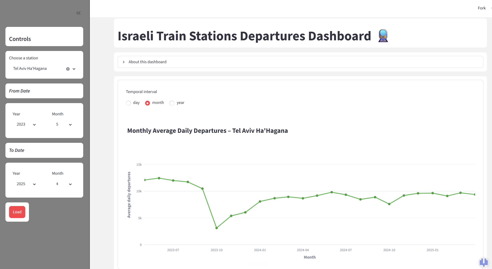
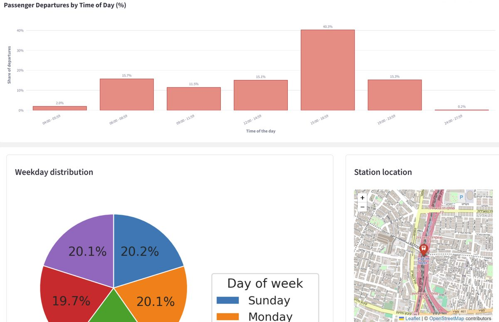

# Train Station Departures Dashboard (Streamlit)

An interactive **Streamlit dashboard** for exploring **passenger departures patterns at Israel Railways train stations** based on official public transportation data.

Select a station to analyze monthly trends, temporal usage patterns, weekday distributions, and geographic location.

---

## Live Application

The dashboard is publicly available on Streamlit Community Cloud:

**https://israeltrainstationsproject.streamlit.app/**





---

## Purpose
This project is intended for:
- Exploratory analysis of public transportation demand
- Visual comparison between train stations
- Demonstrating data engineering, visualization, and dashboard design skills

---

## Features

- **Station selector**
  - Choose any Israel Railways train station from the GTFS dataset

- **Flexible time resolution**
  - Analyze data by **day**, **month**, or **year**
  - Monthly & yearly views present **average daily departures**

- **Custom date range**
  - Select **From** and **To** year/month
  - Instantly focus on a specific analysis period

- **Working-day logic**
  - Automatically excludes **Fridays, Saturdays, and Israeli public holidays**

- **Time-of-day distribution**
  - Passenger departures grouped into **7 service periods**
  - Displayed as percentage share

- **Geographic visualization**
  - Interactive station location map (Folium)

- **Fast experience**
  - Smart caching prevents repeated API calls and improves responsiveness

---

## Methodology

- Daily activation columns (`day_1`, `day_2`, …) are aggregated per month
- Non-service days are excluded:
  - Fridays and Saturdays
  - Israeli public holidays and their eves
- Time-of-day analysis aggregates all working days across the year
- Percent distributions are calculated relative to total yearly activations

The dashboard covers **2023 to 2025**: one data.gov.il resource per year, merged per station.

---

## Tech Stack

- **Python**
- **Streamlit** (dashboard framework)
- **Pandas** (data processing)
- **NumPy** (numerical operations)
- **Requests** (API access)
- **Plotly Express** (interactive charts)
- **Matplotlib / Seaborn** (static charts)
- **Folium** (interactive maps)
- **streamlit-folium** (Folium integration)
- **pyluach** (Jewish holiday calendar)

---

## Data Sources

- **Passenger activation data**
  - Israeli Government Open Data Portal  
    https://data.gov.il

- **GTFS station data**
  - Used for station names and geographic coordinates
  - Downloded from here: https://gtfs.mot.gov.il/gtfsfiles/

---

## Project Structure

```text
israel_train_stations_project/
├── main.py                    Streamlit application
├── config.py                  data.gov.il endpoints, yearly resource IDs, station codes
├── data/
│   ├── ckan_client.py         fetch and cache station activations from data.gov.il
│   ├── gtfs.py                station names and coordinates from GTFS
│   └── stops.txt              GTFS stops file
├── data_agg/
│   └── data_aggregators.py    daily averages, time-of-day and weekday patterns
├── calendar_utils/
│   └── calendar_helpers.py    service days: excludes weekends and Israeli holidays (pyluach)
├── visualization/
│   ├── plots.py               Plotly / Matplotlib charts
│   └── maps.py                Folium station map
└── requirements.txt
```

## Getting Started

### 1) Clone the repository

```bash
git clone https://github.com/ofer-geo/israel_train_stations_project.git
cd israel_train_stations_project
```

### 2) Install dependencies
```bash
pip install -r requirements.txt
```
### 3) Run the application
```bash
streamlit run main.py
```

The app will open automatically in your browser at:
```arduino
http://localhost:8501
```

---

## Deployment
This project is designed to run on *Streamlit Community Cloud* directly from this repository.

- Dependencies are defined in requirements.txt

- All file paths are project-relative

- No local configuration is required 

After deployment, the app can be shared via a public URL.

---

## Author

**Ofer Shahal**, [portfolio](https://ofer-geo.github.io/personal_portfolio/projects/train-stations-dashboard/)

## License

[MIT](LICENSE)
